# Les dépendances entre les parties du projet

Fichier fabriqué par `pnpm arch` (`scripts/architecture.mjs`) : ne pas le modifier à la main.
Chaque flèche dit « importe » (tests exclus). Le schéma ne change que si une nouvelle relation apparaît
entre deux parties : c'est le moment de se demander si elle est voulue.

```mermaid
flowchart LR
  subgraph appli["apps/app (iOS, Android, web)"]
    n0["pages"]
    n1["écrans"]
    n2["composants"]
    n3["catalogue"]
    n4["navigation"]
    n5["client API"]
    n24["réglages"]
  end
  subgraph appliDomaines["apps/app : domaines"]
    n6["accounts"]
    n7["blocks"]
    n8["comments"]
    n9["email"]
    n10["feed"]
    n11["follows"]
    n12["media"]
    n13["members"]
    n14["mentions"]
    n15["moderation"]
    n16["notes"]
    n17["notifications"]
    n18["profile"]
    n19["projects"]
    n20["reactions"]
    n21["reports"]
    n22["search"]
    n23["tools"]
  end
  subgraph api["apps/api (serveur)"]
    n25["routes"]
    n48["socle"]
  end
  subgraph apiDomaines["apps/api : domaines"]
    n26["auth"]
    n27["blocks"]
    n28["comments"]
    n29["email"]
    n30["feed"]
    n31["follows"]
    n32["handles"]
    n33["jobs"]
    n34["media"]
    n35["mentions"]
    n36["moderation"]
    n37["notes"]
    n38["notifications"]
    n39["profile"]
    n40["projects"]
    n41["reactions"]
    n42["removals"]
    n43["reports"]
    n44["search"]
    n45["security"]
    n46["suspension"]
    n47["tools"]
  end
  subgraph paquets["packages (partagés)"]
    n49["contrats"]
    n50["base de données"]
    n51["traductions"]
    n52["marque"]
  end
  n0 --> n1
  n0 --> n2
  n0 --> n3
  n0 --> n4
  n0 --> n5
  n0 --> n6
  n0 --> n18
  n0 --> n24
  n0 --> n51
  n1 --> n2
  n1 --> n4
  n1 --> n5
  n1 --> n6
  n1 --> n7
  n1 --> n8
  n1 --> n9
  n1 --> n10
  n1 --> n11
  n1 --> n13
  n1 --> n14
  n1 --> n15
  n1 --> n16
  n1 --> n17
  n1 --> n18
  n1 --> n19
  n1 --> n20
  n1 --> n21
  n1 --> n22
  n1 --> n23
  n1 --> n24
  n1 --> n49
  n1 --> n51
  n1 --> n52
  n2 --> n18
  n2 --> n24
  n2 --> n49
  n2 --> n51
  n2 --> n52
  n3 --> n2
  n3 --> n49
  n3 --> n52
  n4 --> n2
  n4 --> n5
  n4 --> n6
  n4 --> n15
  n4 --> n17
  n4 --> n18
  n5 --> n6
  n5 --> n24
  n6 --> n5
  n6 --> n24
  n6 --> n49
  n6 --> n52
  n7 --> n2
  n7 --> n4
  n7 --> n5
  n7 --> n10
  n7 --> n17
  n7 --> n49
  n8 --> n5
  n8 --> n19
  n8 --> n49
  n9 --> n5
  n9 --> n24
  n9 --> n49
  n10 --> n2
  n10 --> n5
  n10 --> n16
  n10 --> n19
  n10 --> n49
  n11 --> n5
  n11 --> n10
  n11 --> n19
  n13 --> n5
  n13 --> n49
  n14 --> n5
  n14 --> n49
  n15 --> n5
  n15 --> n6
  n15 --> n18
  n15 --> n49
  n16 --> n2
  n16 --> n5
  n16 --> n10
  n16 --> n19
  n16 --> n24
  n16 --> n49
  n17 --> n2
  n17 --> n5
  n17 --> n49
  n18 --> n5
  n18 --> n6
  n18 --> n12
  n18 --> n49
  n19 --> n2
  n19 --> n5
  n19 --> n12
  n19 --> n18
  n19 --> n49
  n20 --> n5
  n20 --> n19
  n21 --> n5
  n21 --> n49
  n22 --> n5
  n22 --> n49
  n23 --> n5
  n23 --> n49
  n24 --> n51
  n25 --> n26
  n25 --> n27
  n25 --> n28
  n25 --> n29
  n25 --> n30
  n25 --> n31
  n25 --> n32
  n25 --> n34
  n25 --> n35
  n25 --> n36
  n25 --> n37
  n25 --> n38
  n25 --> n39
  n25 --> n40
  n25 --> n41
  n25 --> n43
  n25 --> n44
  n25 --> n46
  n25 --> n47
  n25 --> n48
  n25 --> n49
  n25 --> n50
  n25 --> n52
  n26 --> n28
  n26 --> n29
  n26 --> n32
  n26 --> n36
  n26 --> n40
  n26 --> n43
  n26 --> n46
  n26 --> n48
  n26 --> n49
  n26 --> n50
  n26 --> n51
  n26 --> n52
  n27 --> n32
  n27 --> n39
  n27 --> n49
  n27 --> n50
  n28 --> n27
  n28 --> n35
  n28 --> n39
  n28 --> n40
  n28 --> n42
  n28 --> n48
  n28 --> n49
  n28 --> n50
  n29 --> n38
  n29 --> n49
  n29 --> n50
  n29 --> n51
  n29 --> n52
  n30 --> n31
  n30 --> n37
  n30 --> n40
  n30 --> n48
  n30 --> n49
  n30 --> n50
  n31 --> n40
  n31 --> n50
  n32 --> n38
  n32 --> n48
  n32 --> n49
  n32 --> n50
  n32 --> n51
  n33 --> n26
  n33 --> n29
  n33 --> n32
  n33 --> n38
  n33 --> n43
  n33 --> n46
  n33 --> n48
  n33 --> n49
  n33 --> n50
  n35 --> n27
  n35 --> n28
  n35 --> n39
  n35 --> n49
  n35 --> n50
  n36 --> n29
  n36 --> n43
  n36 --> n46
  n36 --> n48
  n36 --> n49
  n36 --> n50
  n37 --> n42
  n37 --> n49
  n37 --> n50
  n38 --> n27
  n38 --> n39
  n38 --> n40
  n38 --> n42
  n38 --> n46
  n38 --> n49
  n38 --> n50
  n39 --> n32
  n39 --> n46
  n39 --> n50
  n39 --> n51
  n40 --> n27
  n40 --> n28
  n40 --> n31
  n40 --> n37
  n40 --> n39
  n40 --> n41
  n40 --> n42
  n40 --> n49
  n40 --> n50
  n41 --> n40
  n41 --> n49
  n41 --> n50
  n42 --> n49
  n42 --> n50
  n43 --> n27
  n43 --> n28
  n43 --> n32
  n43 --> n33
  n43 --> n36
  n43 --> n38
  n43 --> n40
  n43 --> n46
  n43 --> n48
  n43 --> n49
  n43 --> n50
  n44 --> n27
  n44 --> n31
  n44 --> n39
  n44 --> n40
  n44 --> n47
  n44 --> n49
  n44 --> n50
  n45 --> n48
  n46 --> n38
  n46 --> n48
  n46 --> n49
  n46 --> n50
  n47 --> n40
  n47 --> n44
  n47 --> n49
  n47 --> n50
  n48 --> n25
  n48 --> n26
  n48 --> n29
  n48 --> n32
  n48 --> n33
  n48 --> n34
  n48 --> n45
  n48 --> n46
  n48 --> n49
  n48 --> n50
  n48 --> n51
  n48 --> n52
  n49 --> n51
  n51 --> n52
```

## Les règles vérifiées

- L'appli n'importe jamais le code de l'API ni la base de données (secrets, accès direct).
- L'API n'importe jamais le code de l'appli.
- Un paquet partagé (packages/) n'importe jamais une application.
- Les contrats, partagés avec l'appli, n'importent jamais la base de données.
- Un composant (src/ui) ne connaît ni les écrans, ni les appels à l’API, ni la navigation.
- Le code de production n’importe jamais les outils de test.

Exceptions acceptées :

- `apps/app/src/ui/LanguageSwitcher.tsx -> apps/app/src/profile/useChooseLanguage.ts`
